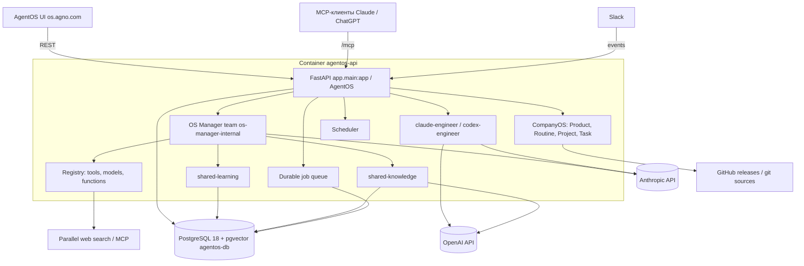

# Architecture Specification

## Purpose
Backend-приложение на Python: тонкий слой конфигурации (`app/`, `agents/`, `db/`, `evals/`) поверх runtime Agno AgentOS. Слои: клиенты (AgentOS UI, MCP-клиенты, Slack, REST) → FastAPI-приложение AgentOS → агенты/команды/CompanyOS/планировщик/очередь → PostgreSQL (+pgvector) и внешние LLM/сервисы.

## Requirements

### Requirement: Слои и их расположение
Система MUST придерживаться следующего размещения кода:
- `app/main.py` — сборка и конфигурация `AgentOS`;
- `app/settings.py` — фабрики моделей `default_model()` и `manager_model()`;
- `app/registry.py` — `Registry`, `shared_knowledge`, `shared_learning`, `shared_notes`, веб-инструменты;
- `app/interfaces.py` — MCP-аутентификация и подключение Slack;
- `app/company.py` — продукты и рутины CompanyOS;
- `app/sandbox.py` — опциональные sandbox-провайдеры и `REPOSITORY`;
- `app/config.yaml` — manifest описаний и `quick_prompts` для UI;
- `agents/engineers.py` — внешние агенты `claude_engineer`, `codex_engineer` и список `engineers`;
- `db/__init__.py`, `db/url.py` — подключение к PostgreSQL и фабрика `Knowledge`;
- `evals/` — смоук-проверки (`python -m evals`).

#### Scenario: Добавление зарегистрированного агента
- GIVEN нужен новый агент кода
- WHEN разработчик добавляет его в `agents/` и в список, передаваемый в `AgentOS(agents=[...])`
- THEN агент MUST появиться в `GET /agents` после перезапуска приложения

### Requirement: Конфигурация AgentOS
Экземпляр `AgentOS` MUST создаваться с параметрами: `mcp=True`, `tracing=True`, `scheduler=True`, `user_isolation=True`, `user_directory=True`, `queue=QueueConfig(durable=True, db=db)`, `knowledge=[shared_knowledge]`, `agents=[*engineers]`, `registry=registry`, `config=app/config.yaml`, `manager=OSManager(root=<корень репозитория>, model=manager_model(), learning=shared_learning)`, `company=CompanyConfig(products=products, model=manager_model())`.

#### Scenario: Проверка конфигурации
- GIVEN платформа запущена
- WHEN клиент вызывает `GET /info`
- THEN ответ MUST содержать `mcp.enabled: true`, `user_isolation: true`, `agno_version: "3.1.10"`

### Requirement: Единая база данных
Все компоненты (сессии, память, learning, метрики, evals, CompanyOS, очередь, трассировки, содержимое знаний) MUST использовать одну БД PostgreSQL с идентификатором `agentos-db` (`DB_ID` в `db/__init__.py`). Содержимое знаний MUST храниться в таблице `shared_knowledge_contents`, векторы — в таблице `shared_knowledge`.

#### Scenario: Состояние таблиц
- GIVEN приложение стартовало впервые
- WHEN читается `GET /config`
- THEN `os_database` MUST быть `agentos-db`, а таблицы `agno_sessions`, `agno_memories`, `agno_learnings`, `agno_metrics`, `agno_eval_runs`, `agno_company_*` MUST быть перечислены в соответствующих разделах

### Requirement: Миграции и создание таблиц
Приложение MUST создавать недостающие таблицы при старте (в логах: `Created table ai.agno_jobs`, `ai.agno_company_projects` и др.). Явные миграции MAY запускаться через `POST /databases/all/migrate`.

#### Scenario: Первый запуск
- GIVEN пустой том `pgdata`
- WHEN запускается `agentos-api`
- THEN приложение MUST создать недостающие таблицы в схеме `ai`

### Requirement: Контейнерная топология
`compose.yaml` MUST определять сервисы `agentos-db` (`agnohq/pgvector:18`, порт `127.0.0.1:5432`, том `pgdata`) и `agentos-api` (сборка из `Dockerfile`, target `agentos`, порт `127.0.0.1:8000`, `depends_on: agentos-db`, сеть `agentos`). Dockerfile MUST содержать stages `base`, `sandbox`, `agentos`; entrypoint (`scripts/entrypoint.sh`) MUST ожидать готовность БД, если `WAIT_FOR_DB` равен `true`/`True`.

#### Scenario: Ожидание БД
- GIVEN `WAIT_FOR_DB=True`
- WHEN стартует контейнер `agentos-api`
- THEN entrypoint MUST дождаться TCP-доступа к `DB_HOST:DB_PORT` (таймаут 300 секунд), иначе процесс MUST завершиться с ошибкой

### Requirement: Dev и production режимы
В dev-режиме (`compose.yaml`) приложение MUST запускаться с `--reload` и bind-mount `.:/app`, `RUNTIME_ENV=dev`. В production-override (`compose.prod.yaml`) приложение MUST запускаться без reload, без bind-mount, с `RUNTIME_ENV=prd` и `AGNO_DEBUG=False`, а порт Postgres MUST быть привязан к `127.0.0.1`.

#### Scenario: Production-запуск
- GIVEN используется `docker compose -f compose.yaml -f compose.prod.yaml up -d --build`
- WHEN приложение стартует
- THEN авторизация MUST быть включена (`authorization = RUNTIME_ENV != "dev"`)
