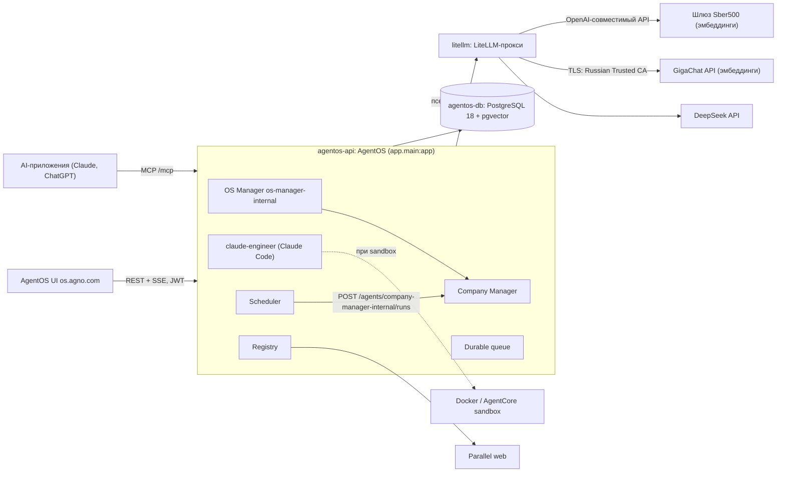

# Architecture Specification

## Purpose
Слои и связи текущего кода. Целевая архитектура Authorled (три сервиса, ядро, свои маршруты `/api/v1/`, Redis, LiteLLM) описана в `openspec/context/03-architecture.md` и ADR-001/002 и в коде не реализована.

## Requirements

### Requirement: Слои приложения
Код бэкенда лежит в `agno/` и MUST разделяться так:
- `app/main.py` — сборка `AgentOS`;
- `app/interfaces.py` — MCP OAuth, MCP-инструменты;
- `app/auth/` — кодовая часть модуля `auth`: проверка JWT Authentik, сопоставление групп и scopes, `Principal`, доступ к проекту;
- `app/company.py` — Products, Sources, Routines;
- `app/config.yaml` — манифест компонентов;
- `app/registry.py` — реестр Studio, shared knowledge/learning/notes;
- `app/settings.py` — фабрики моделей;
- `app/sandbox.py` — провайдеры sandbox и `REPOSITORY`;
- `agents/engineers.py` — инженеры;
- `db/` — подключение к PostgreSQL и знания;
- `evals/` — кейсы и CLI.

Вне `agno/`:
- `auth/` (корень репозитория) — деплой-часть модуля `auth`: сервисы и blueprints Authentik, оформление, инициализация БД, выгрузка ключей;
- `web/` (корень репозитория) — фронтенд (тонкий клиент без своей БД, ADR-001); `web/src/design-system/` — токены, темы, шрифты и базовые компоненты дизайн-системы.

#### Scenario: Порядок сборки
- GIVEN импортируется `app.main`
- WHEN создаётся `AgentOS`
- THEN `attach_interfaces(agent_os)` MUST вызываться после создания и до `agent_os.get_app()`

#### Scenario: Авторизация подключается модулем
- GIVEN импортируется `app.main`
- WHEN создаётся `AgentOS`
- THEN настройка авторизации и изоляции MUST браться из `app/auth/`, а `app/main.py` MUST NOT содержать разбора токенов и claims

#### Scenario: Фронтенд отделён от бэкенда
- GIVEN в репозитории есть `web/`
- WHEN собирается образ бэкенда по `agno/Dockerfile`
- THEN образ MUST NOT зависеть от содержимого `web/`, а код `web/` MUST NOT импортировать модули бэкенда

### Requirement: Единая БД
OS, Company, queue, learning, notes, реестр и инженеры MUST использовать один `PostgresDb` с ID `agentos-db`, возвращаемый кэшированной `get_postgres_db()`. Content-адаптер знаний MUST иметь собственный ID `agentos-db-<table>_contents`.

#### Scenario: Одна БД в конфигурации
- GIVEN платформа запущена
- WHEN клиент выполняет `GET /config`
- THEN `databases` MUST быть `["agentos-db"]`

### Requirement: Модели
`default_model()` MUST возвращать при каждом вызове новый экземпляр модели DeepSeek с псевдонимом прокси `deepseek-fast` без режима размышлений; `manager_model()` MUST возвращать модель с псевдонимом `deepseek-thinking` в режиме размышлений и MUST использоваться OS Manager и CompanyOS. Обе модели MUST обращаться к LiteLLM-прокси по `LITELLM_URL` с ключом `LITELLM_API_KEY`. Псевдонимы MUST объявляться только в `app/settings.py`; инженеры MUST брать их оттуда и MUST NOT задавать имена моделей сами.

#### Scenario: Модель менеджера
- GIVEN платформа запущена
- WHEN клиент выполняет `GET /teams`
- THEN `os-manager-internal` MUST иметь модель `deepseek-thinking`

### Requirement: Sandbox
`sandbox_provider()` MUST возвращать `None`; тогда инженеры MUST исполняться на сервере AgentOS в корне репозитория. `docker_sandbox()` MUST создавать `DockerSandbox` (образ `agno-sandbox:local`, сеть `isolated`, `workspace_mb=2048`, checkpoints в `<root>/tmp/checkpoints`). `agentcore_sandbox(runtime_arn)` MUST требовать смонтированный том `/data`, иначе MUST завершаться `ValueError`.

#### Scenario: AgentCore без тома
- GIVEN `/data` не является точкой монтирования
- WHEN вызывается `agentcore_sandbox("arn")`
- THEN функция MUST завершиться `ValueError("Mount a persistent volume at /data before enabling AgentCore")`

### Requirement: Подключение к БД
URL БД MUST собираться из `DB_DRIVER`, `DB_USER`, `DB_PASS`, `DB_HOST`, `DB_PORT`, `DB_DATABASE` (`db/url.py`). Все переменные MUST быть заданы: при отсутствии любой из них или нечисловом `DB_PORT` приложение MUST завершать запуск ошибкой, называющей переменную; значения по умолчанию MUST NOT подставляться. `DB_USER` MUST быть ролью `agentos` без прав суперпользователя, которая владеет схемой `ai` и не имеет прав на схему `authentik`; загрузочный суперпользователь базы MUST использоваться только шагами инициализации и администрирования, а не API. Роль `agentos`, расширение `vector` и владение объектами схемы `ai` MUST готовиться идемпотентным шагом инициализации до старта API; если шаг не выполнился, API MUST NOT стартовать. Пароль роли `agentos` MUST задаваться обязательной переменной `AGENTOS_DB_PASSWORD`.

#### Scenario: Compose
- GIVEN контейнер `agentos-api` запущен через `compose.yaml`
- WHEN строится URL
- THEN `DB_HOST` MUST быть `agentos-db`, `DB_PORT` `5432`
- AND `DB_USER` MUST быть `agentos`

#### Scenario: Нет переменной подключения
- GIVEN `DB_PASS` не задан
- WHEN запускается API
- THEN запуск MUST завершиться ошибкой, называющей `DB_PASS`

#### Scenario: Роль API не суперпользователь
- GIVEN API запущен через `compose.yaml`
- WHEN проверяются атрибуты роли, под которой подключается API
- THEN роль MUST NOT иметь `SUPERUSER`

#### Scenario: Нет пароля роли Agno
- GIVEN `AGENTOS_DB_PASSWORD` не задан в `.env`
- WHEN выполняется `docker compose up`
- THEN команда MUST завершиться ошибкой, называющей `AGENTOS_DB_PASSWORD`

#### Scenario: Существующая база
- GIVEN база, в которой схема `ai` и её таблицы созданы загрузочным суперпользователем
- WHEN выполняется шаг инициализации и запускается API
- THEN владельцем схемы `ai` и её таблиц MUST стать роль `agentos`
- AND сохранённые сессии, знания и записи Company MUST остаться доступны через API

### Requirement: Раскладка монорепозитория
Репозиторий MUST состоять из трёх модулей верхнего уровня и общего корня:
- `agno/` — бэкенд на Agno: код, зависимости, образ API, прокси моделей, compose-фрагмент `agno/compose.yaml` и скрипты только бэкенда;
- `web/` — фронтенд;
- `auth/` — деплой-часть модуля авторизации.

В корне MUST оставаться только общее для модулей:
- `compose.yaml`, который подключает фрагменты модулей и объявляет общую PostgreSQL;
- `compose.prod.yaml`, `example.env`, `.env`;
- `openspec/`, `business-intents/`, `.agents/`, `.github/`, `AGENTS.md`/`CLAUDE.md`, `README.md`, `LICENSE`, `tmp/`;
- `scripts/` со скриптами всего стека.

В корне MUST NOT быть кода бэкенда и папки `modules/`. Пути кода бэкенда в спеках (`app/…`, `agents/…`, `db/…`, `evals/…`) MUST читаться относительно `agno/`; остальные пути — относительно корня репозитория.

Корень репозитория MUST задаваться в коде одной константой. Через неё MUST определяться:
- корень OS Manager;
- рабочая папка инженера без песочницы;
- локальный Git Source компании;
- файл `.env` для evals;
- каталог checkpoints.

Константа MUST указывать на корень репозитория, а не на `agno/`. Если в вычисленном корне нет `AGENTS.md`, импорт MUST завершаться ошибкой, называющей путь; другой каталог MUST NOT подставляться.

#### Scenario: Состав верхнего уровня
- GIVEN репозиторий после переноса
- WHEN перечисляются отслеживаемые git каталоги верхнего уровня
- THEN каталоги MUST быть только из списка `agno`, `web`, `auth`, `scripts`, `openspec`, `business-intents`, `.agents`, `.claude`, `.github`
- AND каталогов `app`, `agents`, `db`, `evals`, `litellm`, `docs`, `modules` в корне MUST NOT быть

#### Scenario: OS Manager видит весь репозиторий
- GIVEN API запущен локально или в контейнере
- WHEN определяется корень OS Manager и рабочая папка инженера
- THEN оба MUST указывать на каталог, где лежат `AGENTS.md`, `openspec/` и `agno/`

#### Scenario: Корень не найден
- GIVEN в вычисленном корне репозитория нет `AGENTS.md`
- WHEN импортируется модуль с константой корня
- THEN импорт MUST завершиться ошибкой, называющей проверенный путь

#### Scenario: Данные сохранены после переноса
- GIVEN существующий том `authorled_pgdata` с сессиями и записями Company
- WHEN после переноса выполняется `docker compose up -d --build`
- THEN compose-проект MUST называться `authorled` и использовать тот же том
- AND сохранённые записи MUST быть доступны через API
