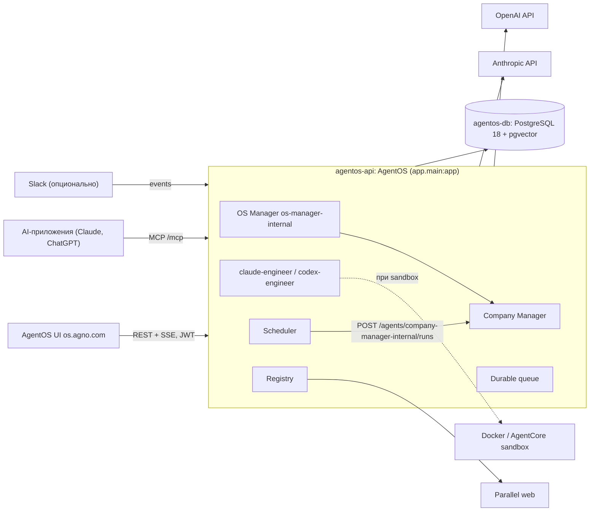

# Architecture Specification

## Purpose
Слои и связи текущего кода. Целевая архитектура Authorled (три сервиса, ядро, свои маршруты `/api/v1/`, Valkey, LiteLLM) описана в `openspec/context/03-architecture.md` и ADR-001/002 и в коде не реализована.

## Requirements

### Requirement: Слои приложения
Код MUST разделяться так:
- `app/main.py` — сборка `AgentOS`;
- `app/interfaces.py` — MCP OAuth, MCP-инструменты, Slack;
- `app/company.py` — Products, Sources, Routines;
- `app/config.yaml` — манифест компонентов;
- `app/registry.py` — реестр Studio, shared knowledge/learning/notes;
- `app/settings.py` — фабрики моделей;
- `app/sandbox.py` — провайдеры sandbox и `REPOSITORY`;
- `agents/engineers.py` — инженеры;
- `db/` — подключение к PostgreSQL и знания;
- `evals/` — кейсы и CLI.

#### Scenario: Порядок сборки
- GIVEN импортируется `app.main`
- WHEN создаётся `AgentOS`
- THEN `attach_interfaces(agent_os)` MUST вызываться после создания и до `agent_os.get_app()`

### Requirement: Единая БД
OS, Company, queue, learning, notes, реестр и инженеры MUST использовать один `PostgresDb` с ID `agentos-db`, возвращаемый кэшированной `get_postgres_db()`. Content-адаптер знаний MUST иметь собственный ID `agentos-db-<table>_contents`.

#### Scenario: Одна БД в конфигурации
- GIVEN платформа запущена
- WHEN клиент выполняет `GET /config`
- THEN `databases` MUST быть `["agentos-db"]`

### Requirement: Модели
`default_model()` MUST возвращать новый `Claude(id="claude-sonnet-5-5")` при каждом вызове; `manager_model()` MUST возвращать `Claude(id="claude-opus-5-5")` и MUST использоваться OS Manager и CompanyOS. Инженеры задают модели напрямую (`claude-opus-5-5`, `gpt-6.1-sol`).

#### Scenario: Модель менеджера
- GIVEN платформа запущена
- WHEN клиент выполняет `GET /teams`
- THEN `os-manager-internal` MUST иметь модель `claude-opus-5-5`

### Requirement: Sandbox
`sandbox_provider()` MUST возвращать `None`; тогда инженеры MUST исполняться на сервере AgentOS в корне репозитория. `docker_sandbox()` MUST создавать `DockerSandbox` (образ `agno-sandbox:local`, сеть `isolated`, `workspace_mb=2048`, checkpoints в `<root>/tmp/checkpoints`). `agentcore_sandbox(runtime_arn)` MUST требовать смонтированный том `/data`, иначе MUST завершаться `ValueError`.

#### Scenario: AgentCore без тома
- GIVEN `/data` не является точкой монтирования
- WHEN вызывается `agentcore_sandbox("arn")`
- THEN функция MUST завершиться `ValueError("Mount a persistent volume at /data before enabling AgentCore")`

### Requirement: Подключение к БД
URL БД MUST собираться из `DB_DRIVER`, `DB_USER`, `DB_PASS`, `DB_HOST`, `DB_PORT`, `DB_DATABASE` (`db/url.py`). При отсутствии переменных код подставляет значения разработки (`postgresql+psycopg`, `ai`/`ai`, `localhost:5432`, `ai`).

#### Scenario: Compose
- GIVEN контейнер `agentos-api` запущен через `compose.yaml`
- WHEN строится URL
- THEN `DB_HOST` MUST быть `agentos-db`, `DB_PORT` `5432`
